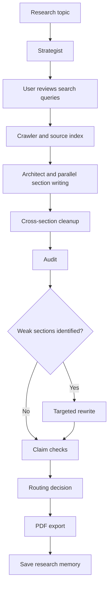

# AI Research Agent

A research workflow that plans web searches, gathers sources, writes a
structured report, audits the draft, revises weak sections, and exports
a cited PDF.

Getting a model to write a report is straightforward. The harder part is
making the research process inspectable: which sources were used, which
claims they support, what the review stage changed, and where the system
still gets things wrong.

I built this project to work through those problems. It combines
LLM-driven planning and writing with deterministic checks, a human
review step, and persistent research memory.

The output is a research draft—not independently verified publication.
Critical facts still need human review.


## Sample reports

These reports were generated using the current version of this pipeline.
They demonstrate the output format and workflow. Generated reports should
still be reviewed before being used for important decisions.

https://github.com/Sujal-Kandi/AI_RESEARCH_AGENT/blob/main/REPORT_FROM_TRADING_HOUSE_TO_CHIPMAKER_SA.pdf
https://github.com/Sujal-Kandi/AI_RESEARCH_AGENT/blob/main/REPORT_SUBHAS_CHANDRA_BOSE_FROM_EARLY_SCH.pdf
https://github.com/Sujal-Kandi/AI_RESEARCH_AGENT/blob/main/REPORT_FROM_VILLAGE_GREENS_TO_GLOBAL_SPECT.pdf


## Contents

- [What it produces](#what-it-produces)
- [The problem](#the-problem)
- [Why this approach](#why-this-approach)
- [Pipeline](#pipeline)
- [How the checks work](#how-the-checks-work)
- [Engineering decisions](#engineering-decisions)
- [Performance](#performance)
- [Known limitations](#known-limitations)
- [Run locally](#run-locally)
- [API](#api)
- [Configuration](#configuration)
- [Project structure](#project-structure)
- [Next work](#next-work)

## What it produces

A PDF report containing:

- A cover page and key findings.
- A table of contents.
- An executive summary.
- Topic-specific research sections.
- Critical and comparative perspectives.
- A final synthesis.
- A numbered source list with URLs.

Example topics included in the repository:

- Nokia.
- Kodak.
- The Dot-Com Bubble.
- NVIDIA H100 vs A100.
- Tesla FSD v12.

These examples demonstrate the output format. They should not be treated
as proof that every statement in a generated report is correct.

## The problem

A report can look finished before the research behind it is finished.

A generated answer may cite a real page without that page supporting the
specific claim. Different sections may use conflicting figures.
A fluent paragraph may repeat an earlier section without adding anything.
An extra review pass may increase latency without improving the result.

I encountered these problems while building and testing the pipeline:

- Source retrieval sometimes returned material about the wrong person
  when names shared a keyword.
- Parallel sections repeated sentences or used different snapshots of
  the same statistic.
- A review loop restarted crawling and writing after a targeted rewrite
  had already completed.
- An audit designed around numerical reports scored narrative topics
  poorly for reasons unrelated to their actual usefulness.
- A report could contain real names and citations but still assert an
  incorrect relationship between those names.

This project addresses some of those failure modes. Others remain open
and are documented below.

## Why this approach

The workflow separates tasks that need different kinds of control.

| Stage | Why it exists |
|---|---|
| Planning | Make the search strategy visible before research begins. |
| Human review | Let the user correct the scope or remove unhelpful queries. |
| Crawling | Build an indexed source pool from live web results. |
| Section planning and writing | Organise evidence into a report rather than one flat summary. |
| Audit | Identify measurable weaknesses and possible reasoning problems. |
| Targeted rewriting | Revise flagged sections without automatically regenerating everything. |
| Claim checks | Look for structured evidence mismatches before export. |
| PDF export | Produce a readable, shareable artifact. |
| Research memory | Make previous reports available as context for related runs. |

The architecture has costs: more stages mean more routing logic,
external calls, and failure cases.

I do not assume that a longer workflow is automatically better than a
single-prompt baseline. Comparing the two systematically is part of the
evaluation work still to do.

## Pipeline



### 1. Strategist

The strategist classifies the topic and plans approximately seven to
eight targeted search queries.

Queries cover different angles rather than repeating the topic:
background, achievements, quantitative evidence, failures, comparisons,
and implications where relevant.

It also retrieves related context from long-term research memory.

### 2. Human review

Before the crawler runs, the user can review, edit, or remove the planned
queries.

This gives the user control over the research direction before the
pipeline spends time gathering evidence.

### 3. Crawler

The crawler runs search queries concurrently through Tavily and
deep-fetches selected pages.

It:

- Filters results for topic relevance.
- Normalises URLs to reduce duplicate indexing.
- Prioritises selected official and primary-source domains.
- Builds a numbered source index for citation references.

Source prioritisation is a retrieval heuristic. An official domain is
not automatically relevant, and relevance does not establish correctness.

### 4. Architect

The architect plans section titles and allocates evidence to each
section.

Sections are written concurrently. The report header, key findings,
and executive summary are generated from the finished sections rather
than directly from the initial search results.

After writing, cleanup passes address exact sentence duplication,
selected numerical inconsistencies, and some unsupported technical
entity names.

Those passes have limited scope; they do not establish that the whole
report is factually correct.

### 5. Audit

The audit uses measurable signals, including:

- Citation coverage.
- Corroboration heuristics.
- Numerical-claim density.
- Repetition of figures across sections.

It computes a score and records the deductions.

An LLM review supplements those measurements by identifying possible
reasoning or content weaknesses. It can flag no sections rather than
being required to invent a fixed number of problems.

The audit score is an internal diagnostic—not an independently validated
accuracy score.

### 6. Targeted rewrite

Only flagged sections are rewritten. If no sections are flagged, this
stage is skipped.

The rewriter uses the existing source pool rather than performing a
fresh search for every section.

Completing a targeted rewrite is recorded in workflow state so the
router does not unnecessarily restart the full crawl-and-write cycle.

### 7. Claim checks and routing

The pipeline checks selected structured claims against their cited
source text, then applies its routing rules before export.

The routing includes completion and iteration checks so repeated
refinement cannot continue indefinitely.

See [How the checks work](#how-the-checks-work) for the distinction
between evidence checks and factual verification.

### 8. PDF export and memory

The finished report is rendered as a PDF.

The report is also chunked and stored in ChromaDB for retrieval during
related research runs. Saving is included in the API path as well as
the command-line workflow.

A memory-write failure is handled separately so it does not discard
an otherwise completed report.

## How the checks work

### Citation-linked numerical checks

The checker looks for extracted figures in the text of the source cited
by a sentence.

For claims containing multiple figures, it also checks whether they
occur within a configured character window. The default window is
400 characters.

For example:

> Revenue grew by 18% in Q3 2023.

Finding `18%`, `Q3`, and `2023` somewhere in a long document is weak
evidence. Requiring them to appear near one another can reject some
incorrect combinations.

However, proximity does not prove the relationship between those
values. Nearby figures may still refer to different entities, metrics,
or periods. Formatting and extraction differences can also cause valid
claims to fail.

The current pipeline removes sentences that fail its checks. This can
reduce unsupported content, but it can also remove valid material and
affect readability.

### Cross-section numerical consistency

Parallel sections can use different values from different source
snapshots.

The reconciliation pass extracts citation-associated figures and uses
a proximity-and-citation-frequency heuristic to select a consistent
value.

This is a consistency heuristic, not an authoritative truth check.

Similar values can describe different statistics. Frequently cited
values can be outdated. This pass needs broader evaluation before it
can be relied upon for sensitive reporting.

### Sentence deduplication

Sentences are normalised by lowercasing, stripping citation markers,
and normalising whitespace.

A sentence appearing again in a later section is removed.

This addresses exact normalised duplicates. It does not detect every
paraphrase or repeated idea.

### Topic-aware audit thresholds

Narrative topics such as biographies and history differ from
quantitative technical reports.

The audit uses topic-aware thresholds for figure density, numerical
repetition, and corroboration. This avoids applying one numerical
rubric uniformly to every topic.

Relaxing thresholds does not itself demonstrate better evaluation.
The rubric still needs comparison with manually reviewed reports.

## Engineering decisions

### Avoiding an unnecessary second research cycle

An earlier routing function checked the grounding score and iteration
count without recognising that the targeted rewrite had completed.

For some biography runs, this sent the report back through the crawler
and architect. It added calls and sometimes introduced different source
snapshots into already-revised sections.

The fix was to record completion explicitly and check that state before
routing into further work.

The important change was not a new prompt. It was making the workflow
distinguish unfinished work from completed work.

### Keeping network calls out of writing stages

Earlier versions performed additional searches inside section writing
and rewriting.

Those calls made latency harder to explain because research was
happening outside the crawler stage.

Removing them made execution more predictable. The trade-off is that
the writer and rewriter cannot independently recover evidence missing
from the initial crawl.

### Parallel writing with coordination costs

Writing sections concurrently reduces serial waiting, but each writer
does not see the other writers' finished text.

That creates duplication and consistency problems, which the later
cleanup passes attempt to address.

Concurrency also needs to be balanced against provider rate limits and
multiple simultaneous research requests.

### Separating debug behaviour from production behaviour

Raw report debug files are written only when:

```env
DEBUG_REPORTS=1
```

Normal runs do not write to the shared debug filename.

If debug mode is used with concurrent requests, request-specific output
paths are still preferable to a shared file.

### Handling rate limits

The provider-call logic tracks cooldowns and waits for an available
configured key within a maximum wait budget.

This helps handle temporary rate limits. It does not guarantee completion
or override provider quotas and usage policies.

## Performance

Observed full runs have generally taken approximately **2–4 minutes**,
depending on topic, source availability, provider response times, and
whether rewriting is needed.

These are development observations, not a formal benchmark or a service
guarantee.

An earlier biography run took **7 minutes 39 seconds** and involved
**27 LLM calls**. After removing the unnecessary second crawl-and-write
cycle, a subsequent comparable run took approximately **3 minutes
30 seconds**.

That example illustrates one control-flow improvement. It should not be
interpreted as the expected speedup for every topic.

For reproducible performance comparisons, record:

- Topic and query plan.
- Model and provider.
- Section count.
- Concurrency settings.
- Number of external calls.
- Whether rewriting or refinement ran.
- Memory state.
- Total runtime across repeated runs.

## Known limitations

### Entity relationships can still be wrong

The pipeline has missed claims that connected real entities incorrectly.

For example, the presence of a person's name, an organisation, and a
relationship word across source material does not establish that the
person has that relationship with the organisation.

Current citation and entity checks do not fully solve this problem.

### Retrieved evidence is incomplete

Search snippets and fetched pages may omit context. Relevant pages may
be unavailable, outdated, or excluded during filtering.

### Internal scores are not truth probabilities

Grounding and audit scores describe the pipeline's checks. They should
not be read as the probability that a report is correct.

### Memory can preserve mistakes

Previous reports are generated material, not primary evidence.

Stored context can help future planning, but it can also repeat an
earlier error. Important claims still need checking against appropriate
sources.

### Filtering can reduce completeness

Removing a sentence that fails a heuristic can discard a correct claim
or leave a gap in the argument.

### Users remain responsible for critical review

Do not use generated reports as the sole basis for medical, legal,
financial, or other high-stakes decisions.

## Run locally

### 1. Clone the repository

```bash
git clone [https://github.com/Sujal-Kandi/AI_RESEARCH_AGENT.git](https://github.com/Sujal-Kandi/AI_RESEARCH_AGENT.git)
cd AI_RESEARCH_AGENT
```

### 2. Create a virtual environment

```bash
python -m venv .venv
```

macOS / Linux:

```bash
source .venv/bin/activate
```

Windows PowerShell:

```powershell
.\.venv\Scripts\Activate.ps1
```

### 3. Install dependencies

```bash
pip install -r requirements.txt
```

### 4. Configure environment variables

Create a local `.env` file:

```env
TAVILY_API_KEY=your_tavily_key
GROQ_API_KEY=your_groq_key
GROQ_API_KEY_2=your_second_groq_key
TOGETHER_API_KEY=your_together_key
```

Do not commit real credentials.

Check provider availability, quotas, and pricing before running. This
workflow makes external API calls; local installation does not mean
all processing happens locally.

### 5. Start the web interface

```bash
python api.py
```

Open:

```text
http://localhost:8000
```

Enter a topic, review the planned queries, approve the plan, monitor
progress, and download the PDF.

### Command-line examples

```bash
python agent.py "The Rise and Fall of Nokia"
python agent.py "NVIDIA H100 vs A100 Architecture"
python agent.py "The Dot-Com Bubble"
```

## API

| Method | Endpoint | Purpose |
|---|---|---|
| POST | `/research/plan` | Generate queries for review |
| POST | `/research/start` | Start research from an approved plan |
| GET | `/research/status/{id}` | Poll progress |
| GET | `/research/result/{id}` | View the PDF inline |
| GET | `/research/download/{id}` | Download the PDF |

## Configuration

The following settings are documented by the project:

```env
SECTION_WORKERS=8
DEEP_FETCH_LIMIT=5
SECTION_MIN=3
SECTION_MAX=9

CLAIM_WINDOW=400
REFINE_GROUNDING_FLOOR=0.75
MAX_REFINE_ITERATIONS=2
MAX_WEAK_SECTIONS=3

KEY_COOLDOWN_SECONDS=60
MAX_TOTAL_RATE_LIMIT_WAIT=300

DEBUG_REPORTS=0
```

Concurrency and refinement settings should be chosen together with
provider quotas and workload size.

## Project structure

```text
AI_RESEARCH_AGENT/
├── agent.py          # Pipeline nodes, graph definition, PDF export
├── api.py            # FastAPI endpoints and session management
├── ui.html           # Web interface
├── rag.py            # Persistent research memory
├── tools.py          # Search and arXiv tools
├── clear_memory.py   # Reset local research state
└── requirements.txt  # Dependencies
```

### Stack

Python · LangGraph · LangChain · FastAPI · Groq · Together.ai ·
Tavily · ChromaDB · fpdf2

## Next work

- Verify entity relationships against source evidence.
- Evaluate numerical reconciliation across different metrics and dates.
- Compare the pipeline with a simpler baseline.
- Build a repeatable evaluation set spanning narrative and technical topics.
- Measure stage-level latency and external-call usage across repeated runs.
- Check readability after sentence removal and deduplication.

I am documenting the project as I improve it. If you encounter a failure,
a useful issue includes the topic, settings, observed behaviour, and
relevant logs—with credentials and private data removed.
